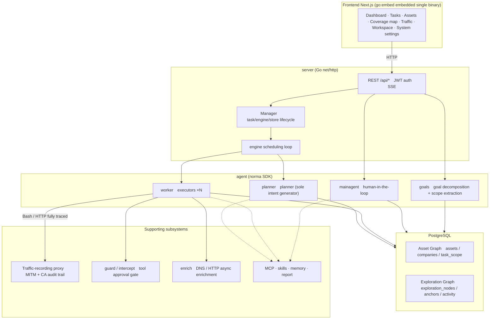
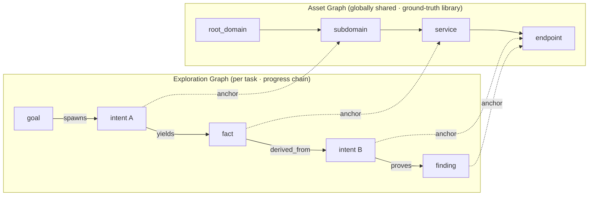
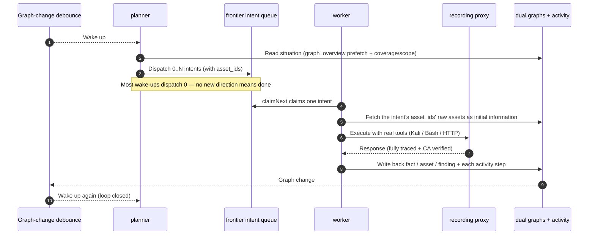
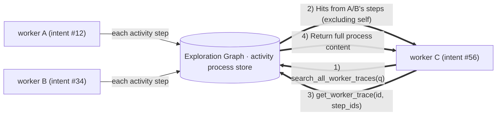
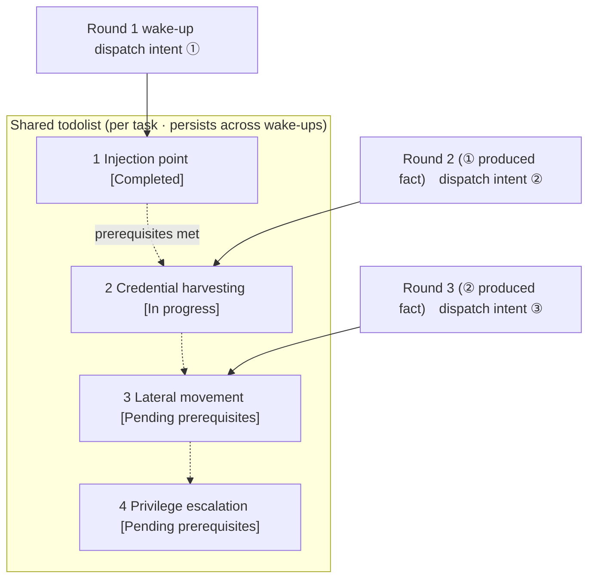

[中文](README.md) | English

> ⚠️ **Unofficial community archive**: The original author Autumn-27's repository has been deleted. This repository is a backup based on ARTEX v0.3.15, preserving the complete commit history, and is not affiliated with the original author. It is open-sourced under AGPL-3.0 (see the License section at the end).
> **Maintenance status**: Archive-first, with limited maintenance. One-click updates from the page depend on Releases; this repository currently provides no release packages — please update by building from source.
> **Usage restrictions**: Personal study, code research, and verification in a local isolated environment only. Actual testing against any online system is prohibited. See the "License & Disclaimer" section at the end for details.

<div align="center">

# ARTEX

AI autonomous penetration testing system (Go backend + Next.js frontend)


🌐 **Online demo**: The original demo domain is no longer available, so no online demo is provided for now. See the screenshots below for the interface.

📦 **This repository is a community archive backup of ARTEX v0.3.15, preserving the complete commit history. The original Docker image source `autumn27/artex` is no longer available; this repository provides no third-party prebuilt images — please build locally from pure source with `docker compose build`.**

</div>

---

## Screenshot Preview

> The screenshots below preview the interface (the original online demo is no longer available).

| Dashboard (Overview / Token usage / Activity stream) | Task list |
| :---: | :---: |
|  |  |

| Task · Execution process (Sessions / Tool calls) | Exploration path |
| :---: | :---: |
|  |  |

| Findings | Assets |
| :---: | :---: |
|  |  |

| Asset coverage map (Force-directed layout · Tested highlighting · Node fold/unfold) |
| :---: |
|  |

| Traffic recording | Human-in-the-loop conversation |
| :---: | :---: |
|  |  |

| Agent management | LLM configuration |
| :---: | :---: |
|  |  |

| Interception approval | Backend logs |
| :---: | :---: |
|  |  |


---

## Approval Record Details

Approval records globally, interception approvals within tasks, and approval cards in conversations can all be expanded to view details. The presentation structure references
[AegisHook's approval detail component](https://github.com/RuoJi6/AegisHook/blob/main/web/src/components/CallDetail.vue), reusing ARTEX's components and theme:


## Asset Sync (ScopeSentry)

Supports syncing asset data directly from ScopeSentry (the original author's repository has been deleted; the feature is retained), eliminating duplicate collection:

- On the "**Asset Sync**" page, enter the ScopeSentry address and API Key to connect the data source;
- Select the sync targets and asset types (domains / subdomains / IPs / ports / sites / endpoints…) by **project** or **task**;
- Import with one click and consolidate by company asset scope, feeding directly into ARTEX's Asset Graph for agent exploration.

---

## Installation

> Requires a **PostgreSQL** database; exploration requires an **LLM** configured (`ANTHROPIC_API_KEY` or `OPENAI_API_KEY`, or set it in the UI).

### Method 1: One-click install script (recommended)

```bash
git clone https://github.com/furs0x/ARTEX.git
cd ARTEX
./install.sh
```

The script will: detect / automatically install Docker, then let you choose **① All Docker** or **② Local build and run**:

- **① All Docker**: enter a Postgres password (press Enter for a random one) → automatically writes `.env` → `docker compose up -d`.
- **② Local run**: choose a database (connect to an existing one / start one with Docker) → generate `config.json` → compile the embedded single binary with `go` → start.

After installation, open **http://localhost:8787** (on first visit, go to `/setup` to set the admin password).

### Method 2: Docker Compose (manual)

```bash
git clone https://github.com/furs0x/ARTEX.git
cd ARTEX
cp .env.example .env          # 填 POSTGRES_PASSWORD、可选 ANTHROPIC_API_KEY
docker compose up -d          # 本地构建镜像 + postgres
# → http://localhost:8787
```

> The original image source `autumn27/artex` has been removed from Docker Hub. This repository provides no third-party prebuilt images — please build locally with `docker compose build`.
> When the image source is unavailable (or you want to modify the code yourself), just build locally from pure source: `docker compose build && docker compose up -d`.
> The Dockerfile uses a multi-stage build (frontend static export → Go static compilation → runtime image) and defaults to China-friendly dependency mirrors; you can override them with `--build-arg GOPROXY=... / --build-arg NPM_REGISTRY=...`.

The image includes common tools (ripgrep/curl/vim/npm/nmap…); `./skills` and `./data` are persisted via bind mounts.

For remote MCP, you can choose `http` (Streamable HTTP) or `sse` (legacy SSE) in the system settings.
A legacy SSE service typically uses `GET /sse` to establish an event stream, then receives JSON-RPC requests through the
`/message?sessionId=...` returned by the service. When configuring, set the URL to `/sse` and fill the request header as
`Authorization=Bearer <token>`.

### Method 3: Download prebuilt binaries (Releases)

The original repository's Releases became invalid when the original repository was deleted, and this repository hosts no binaries. Please build from source using Method 2 or Method 4; the build artifacts are `artex` + `start.sh` (`start.bat` on Windows) + `skills/` + `config.example.json`:

```bash
cp config.example.json config.json   # 填好 database 连接
./start.sh                           # → http://localhost:8787
```

> Please start with `start.sh` / `start.bat`, not by running `./artex` directly. It is a supervisor script: after the program exits, it decides whether to restart it based on the exit code, and the [one-click update](#method-1-one-click-update-from-the-page-recommended) on the page relies on it to complete the swap. If you run `./artex` directly, it will not be restarted after an update.
> To keep it running in the background: `nohup ./start.sh >artex.log 2>&1 &`.

### Method 4: Compile a single binary from source

```bash
# 1) 前端静态导出
cd web && npm ci && npm run build:static && cd ..
# 2) 拷进内嵌目录
cp -r web/out server/webui/dist
# 3) 编译（-tags embedui 才内嵌前端）
CGO_ENABLED=0 go build -tags embedui -o artex ./cmd/artex
./start.sh
```

### Method 5: Build cross-platform release archives

`build.sh` first builds and embeds the frontend, then strips debug information with the Go linker, and compresses the release files into zip archives. In release mode it generates zip packages for Linux amd64/arm64, macOS amd64/arm64, and Windows amd64 by default:

```bash
./build.sh --release
# 产物：dist/artex-0.3.3-*.zip
```

UPX self-extracting binaries may be incompatible with some Linux kernels, virtualization environments, or security policies, so it is disabled by default. You can customize targets with `ARTEX_TARGETS`; if you have confirmed the target runtime environment is compatible, you can explicitly pass `--upx` to further shrink the binary:

```bash
ARTEX_TARGETS=linux/amd64,windows/amd64 ./build.sh --release
./build.sh --target linux/amd64 --upx
```

---

## Updates & Upgrades

> Upgrades only replace the program, not the data: the Postgres data volume `pgdata`, `./data` (jwt.key / SQLite, etc.), and `./skills` are all preserved. **Database migrations require no manual steps** — every time `artex` starts, it idempotently re-runs `schema.sql` (including `ADD COLUMN` / `CREATE INDEX IF NOT EXISTS`), i.e., "restart is migration". Before upgrading, it is still recommended to back up `./data` and the database.

### Method 1: One-click update from the page (recommended)

On the **System Settings** page (sidebar "System Settings" → `/system/settings`), the **Version & Updates** card lets you check for and install new versions directly, without logging into the server.

After clicking "Update": download the release package for the current platform → compare the release's `SHA256SUMS` → smoke-test the new binary with `-h` → stage it as `artex.new` → the program exits and is restarted by `start.sh` / `start.bat` to complete the swap. The page automatically waits for the new version to come online, then refreshes.

- **A failed update leaves no broken program**: if verification or the smoke test fails, the staged file is discarded and the current version keeps running; if the swapped-in new version fails to start 3 times in a row, it automatically rolls back to `artex.old` (the failed one is kept as `artex.failed` for troubleshooting).
- **You can roll back at any time**: the previous version is kept as `artex.old`, and the card has a "Roll back to previous version" button. Note that the database schema is not rolled back.
- **Updating interrupts running tasks** — an update means a restart, so please do it when idle.
- **Dev builds are not offered updates**: when the version is `dev` or a `git describe` string with a suffix, updates are disabled, to avoid an official release overwriting a locally debugged binary.
- **Under Docker, only the program is replaced, not the image**: the playwright / nmap and other toolchains in the image are not upgraded, and rebuilding the container with `docker compose up -d` reverts to the version bundled in the image. To upgrade the image as well, use `docker compose pull artex && docker compose up -d artex`.
- If accessing GitHub requires a proxy, configure the **global proxy** on the same page and the update flow will use it. Updates only download from GitHub domains and enforce HTTPS.

### Method 2: One-click update script

```bash
cd ARTEX
./update.sh
```

The script first optionally runs `git pull` to fetch the latest code, then lets you choose **① Docker update** or **② Local build update** (corresponding to `install.sh`):

- **① Docker**: you can specify the target image tag (press Enter to keep the `.env` value of `ARTEX_TAG`, default `latest`) → `docker compose pull` → `docker compose up -d` (restarting with the new image migrates automatically).
- **② Local**: rebuild the frontend static artifacts → recompile `./artex` (restart the process after completion for it to take effect).

### Method 3: Docker Compose (manual)

```bash
cd ARTEX
git pull                       # 更新 compose / 脚本（可选）
# 指定版本：在 .env 设 ARTEX_TAG=v0.2.0；不设则用 latest
docker compose pull artex
docker compose up -d artex     # 换新镜像重启 → 自动迁移 schema
docker image prune -f          # 清理旧镜像（可选）
```

### Method 4: Prebuilt binaries (Releases)

The original repository's Releases are no longer valid. For updates, use Method 1 (one-click update from the page), Method 2 (update script), or Method 5 (compile from source) — do not download from Releases anymore:

```bash
# 从源码重新构建后，重启 ./start.sh 即可
./start.sh
```

### Method 5: Compile from source

```bash
git pull
cd web && npm ci && npm run build:static && cd ..
cp -r web/out server/webui/dist
CGO_ENABLED=0 go build -tags embedui -o artex ./cmd/artex
# 重启 ./start.sh
```

---

## Configuration

**Database** (`config.json`, or override with the `ARTEX_PG_DSN` environment variable):

```json
{
  "database": {
    "host": "127.0.0.1", "port": 5432,
    "user": "artex", "password": "yourpass",
    "dbname": "artex", "sslmode": "disable"
  }
}
```

**LLM**: `export ANTHROPIC_API_KEY=sk-...` (or `OPENAI_API_KEY`); you can also fill it in on the UI's "LLM Configuration" page.
Optional: `ARTEX_LLM_PROVIDER` / `ARTEX_LLM_MODEL` / `ARTEX_LLM_BASE_URL` / `ARTEX_LLM_PROXY`.

**Concurrency**: the number of work agents per task is configured in "System Settings" (default 3).

**Common parameters**: `./start.sh -addr :8787 -proxy :8788` (`-addr` for frontend + API, `-proxy` for the traffic-recording proxy). The startup script passes the parameters through to `artex` unchanged.

### Reverse proxy deployment (HTTPS / only port 443 open)

The frontend and API/SSE are all served from the same backend port (default `:8787`), and the real-time activity stream uses a **same-origin** address by default, so **there is no need to configure `NEXT_PUBLIC_SSE_BASE`** — just open port 443 to the public internet and keep 8787 on the internal network.

SSE is a long-lived connection with continuous push, so the reverse proxy **must disable buffering**, otherwise the browser connects but receives no events (the activity stream keeps spinning). Nginx example:

```nginx
server {
    listen 443 ssl;
    server_name your.domain.com;
    # ssl_certificate / ssl_certificate_key ...

    location / {
        proxy_pass http://127.0.0.1:8787;
        proxy_set_header Host $host;
        proxy_set_header X-Forwarded-Proto $scheme;

        # SSE 关键项：关缓冲、长超时、HTTP/1.1
        proxy_buffering off;
        proxy_cache off;
        proxy_read_timeout 3600s;
        proxy_http_version 1.1;
        proxy_set_header Connection "";
    }
}
```

> Only when SSE needs a different origin than the page (e.g., a separate subdomain) should you set `NEXT_PUBLIC_SSE_BASE` at **build time** (this variable is baked into the static bundle during `next build`; setting it at container runtime has no effect).

---


## Development

### Manual vulnerability retest

On a task's detail page, the "Retest" tab lets you page through the task's vulnerabilities, view past conclusions and evidence, and manually start a retest. After starting, the current tab is kept, a spinner icon and "Retesting" are shown; once a fix is confirmed, the vulnerability status is updated in sync.

Click "Retest" in the action area of a row in the vulnerability list, or click "Start retest" in the "Vulnerability retest" area of a vulnerability's details, fill in the optional fixed version, test conditions, or constraints, and the system creates an independent retest agent session; after starting, the current page is kept. The flat list, group-by-task, and asset views all support this entry point. While a retest is running, a spinner icon and "Retesting" are shown; click into the corresponding session to view it, and it reverts to "Retest" when finished. A retest does not require restarting the original scan task. Conclusions are "Still reproducible", "Fixed", or "Unconfirmed", and each conclusion, its evidence, and the session link are saved in the vulnerability details.

On first startup, the new backend pre-provisions an editable "Vulnerability retest" (`retester`) agent, whose prompts, LLM, run budget, and tools can be configured in Agent Management. It uses its bound LLM by default, or the globally active configuration if none is bound. When a retest session completes successfully with a "Fixed" conclusion, the system automatically changes the vulnerability's disposition status to "Fixed"; while running, failed, stopped, or with any other conclusion, the original status is kept. Original evidence and reports are always preserved. You can also manually select "Fixed" from the status dropdown. If the same vulnerability is already being retested, the existing session is reused; after a stop, failure, or service restart, a new one can be started.

In this version, history is viewed through vulnerability details and sessions; it is not yet included in vulnerability report exports or task archive packages, nor automatically linked to traffic captures. Demo mode only generates clearly labeled mock records and never requests real targets.

### Local run & testing

```bash
./dev.sh    # 后端(:8787) + 流量代理(:8788) + 前端 next dev(:5173) → http://localhost:5173
```

- Backend: `go run ./cmd/artex` (without `-tags embedui`, the frontend is not embedded)
- Frontend: `cd web && npm run dev` (`/api` is proxied to the backend, with hot reload)
- Tests: `go test ./...`
- Mock preview (no backend): `cd web && NEXT_PUBLIC_MOCK=1 npm run dev`

---

## System Architecture

ARTEX is an **LLM multi-agent autonomous penetration testing system**: a Go monolithic backend (with an embedded Next.js frontend) + PostgreSQL. Agent capabilities are provided by the `norma` SDK (vendored in this repository; it does not depend on the original repository) (`agentcore` / `tool` / `permission` / `harness` / `memory` / `transcript`). Its core is the **dual-graph architecture**, plus two autonomy mechanisms built around it: **process-level information exchange between workers** and **planner multi-round shared todolist for stable attack chains**.

### Overall layering



| Layer | Responsibility |
| --- | --- |
| **Frontend** | Next.js static export, embedded into a single binary with `go:embed`; visualizes tasks/assets/exploration paths/coverage maps, with human-in-the-loop conversations |
| **server** | `net/http` routing + JWT auth + SSE; `Manager` manages the task, engine, and DB store lifecycles |
| **engine** | One `plannerLoop` + N worker goroutines per task; intent claiming, timeout/pause/drain |
| **agent** | goals / planner / worker / mainagent; `ToolSet` exposes the dual graphs as LLM tools |
| **db** | Dual-graph Postgres storage (pgx); schema is idempotently created on every `go:embed` startup |
| **Supporting** | Recording MITM proxy, approval gate, async enrichment, MCP/skills/memory/reports |

### Dual-graph architecture: Exploration Graph + Asset Graph

The system splits "**what the target is**" and "**how thoroughly it has been tested**" into two independent graphs connected by anchors:

- **Asset Graph (globally shared)**: a single ground-truth asset library shared across tasks. Nodes are `root_domain / subdomain / ip / service / app / endpoint`, owned by companies; the parent-child relationships from domain → subdomain → service → endpoint and the deduplication keys are all computed by the program — agents only submit raw information.
- **Exploration Graph (per task)**: the "thinking and progress" process of a single task. Nodes are `goal / intent / fact / finding / hint`, connected by edges such as `spawns / derived_from / yields / proves` into a **lineage chain**, answering "which direction derived from which facts, and what did it produce".
- **The two graphs are connected by anchors**: `exploration_anchors(node_id, asset_id)` anchors intents/facts/findings to specific assets — so you can see which assets an "exploration direction" targets, and reverse-lookup which intents tested a given asset in this task and what facts they produced. This also supports **asset test coverage** and the **asset coverage map** (in-scope assets + tested highlighting).



> Division of labor: the **planner** reads the Exploration Graph's situation, judges targets, and only dispatches **intents** into the frontier when there is a new uncovered direction; a **worker** claims **one intent**, executes it with real tools, and stops after writing new assets/facts/findings back to both graphs. The Asset Graph is shared ground truth; the Exploration Graph is each task's progress chain.

### Engine & intent lifecycle (one exploration loop)

The engine is an **event-driven** loop: any graph change wakes the planner, the planner dispatches intents, workers claim intents, execute, and write back, and the write-back triggers the next round — until the goal is proven (`prove_goal`).



### Process-level information exchange between workers

In a deep exploration, many valuable observations (an error message, a response snippet, a hidden parameter) appear in a worker's **execution process** but are not necessarily written as formal facts. To avoid duplicate work and let workers in the chain stand on each other's shoulders, workers can **retrieve processes across works**:

- `search_all_worker_traces(q)`: keyword search across **other works' execution processes in this task** (automatically excluding steps of your own intent); hits carry `intent_id`;
- `list_worker_traces` / `get_worker_trace(intent_id, step_ids=[…])`: first see which works have run, then fetch the full content of specific steps of a given work for detailed exchange.

So even when the Exploration Graph has no corresponding fact yet, later workers can reuse observations from others' processes — **information flows between workers at the granularity of "execution processes"**, while boundaries stay unchanged (each worker still only handles the intent it claimed).



### Planner multi-round shared todolist → stable attack chains

Real attack chains are often **multi-step sequences with dependencies** (e.g., find an injection point → harvest credentials → move laterally → escalate privileges); dispatching them all in parallel at once would only create chaos. The planner therefore holds a **per-task, cross-wake-up shared planning todo list (todolist)**:

- The planner is event-driven — it wakes on every graph change, but **each wake-up is a fresh session**; the shared todolist lets it **record a serial exploit chain once** and then **dispatch intents step by step by dependency** in later rounds, instead of fully expanding the whole chain up front in one round;
- Each round dispatches intents only for the next step whose "prerequisite steps are complete and whose dependency facts exist", updating the list as it progresses (marking steps already satisfied by facts as complete).



So attack chains still advance **steadily, without duplication or misordering** in an "event-driven + stateless session" environment — this is the key to ARTEX autonomously completing multi-step exploit chains.

---

## Discussion

For questions, please open an Issue directly.

---
## References

https://github.com/oritera/Cairn


## License & Disclaimer

### Open-source license

This project is licensed under the **GNU Affero General Public License v3.0 (AGPL-3.0)**. The full terms are in the [LICENSE](LICENSE) file in the repository root.

This means anyone may freely use, modify, and distribute this project, but **derivative works must likewise be open-sourced under AGPL-3.0**; in particular, **if you modify this project and provide it to users over a network (e.g., deployed as an online service), you must also disclose the complete corresponding source code to those users**.

> ⚠️ **Important notice**: The open-source license itself does not restrict the purposes for which the software may be used. The "Usage Restrictions" and "Disclaimer" below are additional terms and solemn declarations from the author to users. Please be sure to comply with them.

**ARTEX is for personal study, code research, and local technical verification only, and must not be used to conduct actual tests against any online system or website.**

### Permitted scope of use

- Only for **reading, studying, and researching this project's source code**, and for verifying technical principles in a **local isolated environment**;
- Applicable to personal study, academic research, code review, and other non-offensive purposes.

### Prohibited uses

- **It is strictly prohibited to use this tool to scan, probe, exploit, or attack any website, online service, or networked system** (whether or not authorized, and whether or not it is your own asset);
- It is prohibited to use this tool for any actual penetration testing, red-team/blue-team exercises, or production environments;
- It is prohibited to use this tool for illegal intrusion, data theft, extortion, denial of service, or any destructive or criminal activity;
- It is prohibited to use this tool for any activity violating the laws and regulations of your country or region.

### Compliance responsibility

Users must themselves comply with all laws and regulations of their country or region concerning cybersecurity, data protection, and computer crime (in mainland China, including but not limited to the Cybersecurity Law, Data Security Law, Personal Information Protection Law, and related judicial interpretations). **All legal liability and consequences arising from use of this tool are borne solely by the user.**

### Disclaimer

This project is provided "as is" (AS IS), without any express or implied warranties. The authors and contributors bear no responsibility for any direct or indirect losses, data loss, system damage, or legal disputes resulting from use of this tool (whether used properly or not). **Downloading, installing, or using this project indicates that you have read, understood, and agreed to all of the above terms.**
